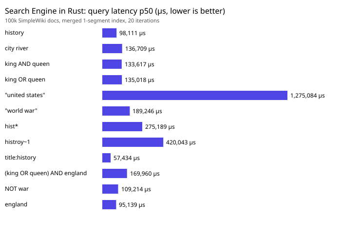
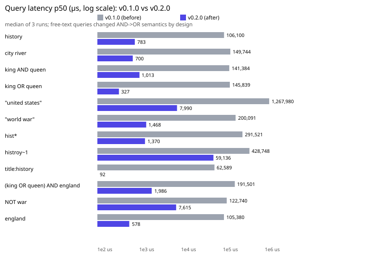
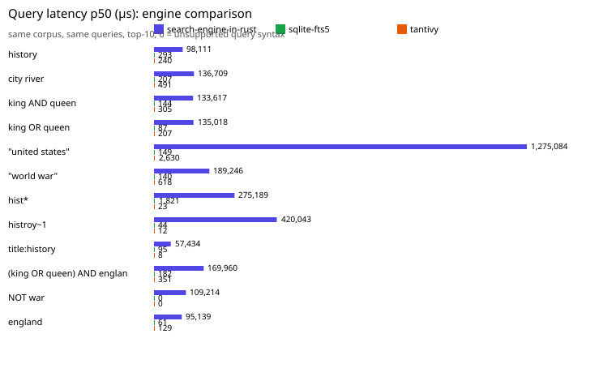

# Search Engine in Rust

[](https://github.com/Kurenaiiiii/Search-Engine-In-Rust/actions/workflows/ci)
[](LICENSE-MIT)

A from-scratch full-text search engine (a mini Lucene) in Rust: BM25 ranking,
boolean/phrase/prefix/fuzzy queries, segments with a write-ahead log, an
HTTP JSON API with a web UI, and a CLI. `se-core` is **zero dependencies**.

## Quick start

```bash
cargo build --release -p se-cli -p se-server
printf '%s\n' \
  '{"title":"Rust search engine","body":"A fast full text search engine written in Rust"}' \
  '{"title":"Cooking pasta","body":"Simple pasta recipes for dinner"}' \
  > docs.ndjson
./target/release/se-cli --dir ./data index docs.ndjson
./target/release/se-cli --dir ./data search "rust AND engine"
./target/release/se-cli --dir ./data serve  # same binary serves the API + UI on :3000
```

Real output (exact commands above, run 2026-10-12):

```
indexed 2 documents in 0.00s (1378 docs/s)
1 hits in 0 ms for: rust AND engine
  #0        2.5286  Rust search engine
           A fast full text search <mark>engine</mark> written in <mark>Rust</mark>
1 hits in 0 ms for: pasta recipes
  #1        2.3153  Cooking pasta
           Simple <mark>pasta</mark> <mark>recipes</mark> for dinner
```

Plain words default to OR (`pasta recipes` matches either word); add
`--minimum-should-match 2` (CLI) or `&msm=2` (API) to require more of them.
`AND OR NOT`, quotes, parens and `field:` keep strict boolean semantics.

Or run the server directly (`SE_TOKEN=secret` enables bearer auth):

```bash
SE_DATA=./data ./target/release/se-server --addr 127.0.0.1:3000
curl 'localhost:3000/api/search?q="search engine"&highlight=1'
```

Open `http://localhost:3000/` for the web UI (search box, highlighted
snippets, latency, stats panel — no external assets).

## Features

- Analysis: Unicode tokenizer, stop words, hand-written Porter-style
  stemmer, edge n-grams; per-field analyzers and boosts.
- Index: immutable segments, delta+varint postings with skip pointers,
  term positions, front-coded term dictionary, stored fields, write buffer,
  WAL with crash recovery **and checkpoint truncation**, tombstone
  deletes/updates, tiered background merges, snapshot readers,
  multi-threaded search.
- Ranking: BM25 (default) + TF-IDF option, top-k heap, field and query
  boosts.
- Queries: free text defaults to scored OR with optional
  `minimum_should_match`; `AND OR NOT`, parens, `"phrases"`, `field:term`,
  `prefix*`, `term~N`, `term^boost`, with clear error messages.
- Extras: `<mark>` snippets, autocomplete suggest, did-you-mean.
- Server: create/bulk/get/update/delete/search/suggest/spell/stats,
  bearer auth, 8 MiB body cap, structured logs, Dockerfile + compose.

## Benchmarks (real, on 4× Xeon E5-2699 v4 / 8 GB RAM, shared VPS)

100k Simple English Wikipedia docs (140 MB raw, CC BY-SA 3.0/GFDL —
Wikipedia contributors via dumps.wikimedia.org). v0.1.0 → v0.2.0
before/after, median of 3 full runs each (20 iterations per query);
per-run load averages (0.2–1.6 on this shared box) are saved with the runs,
so treat small differences as noise. Full methodology and raw JSON in
[`docs/BENCHMARKS.md`](docs/BENCHMARKS.md) and `bench/results/before|after/`.

| engine | index time | docs/s | index size |
|---|---|---|---|
| this engine v0.1.0 | 183 s | 545 | 60 MB inverted + 141 MB stored + 138 MB WAL |
| this engine v0.2.0 | 138 s | 726 | 60 MB inverted + 141 MB stored + 0 MB WAL (truncated) |
| sqlite-fts5 | 11–12 s | ~8,800 | 249 MB |
| tantivy 0.24 | 3.4 s | ~29,300 | n/a (in-RAM) |


Query latency p50 (merged 1-segment index, top-10), before → after:

| query | v0.1.0 | v0.2.0 | sqlite | tantivy |
|---|---|---|---|---|
| `history` | 106.1 ms | 0.78 ms (135×) | 0.29 ms | 0.43 ms |
| `city river` | 149.7 ms | 0.70 ms¹ (214×) | 0.21 ms | 0.69 ms |
| `king AND queen` | 141.4 ms | 1.01 ms (140×) | 0.14 ms | 0.38 ms |
| `king OR queen` | 145.8 ms | 0.33 ms (446×) | 0.09 ms | 0.32 ms |
| `"united states"` (phrase) | 1268.0 ms | 7.99 ms (159×) | 0.15 ms | 2.52 ms |
| `"world war"` (phrase) | 200.1 ms | 1.47 ms (136×) | 0.14 ms | 0.61 ms |
| `hist*` (prefix) | 291.5 ms | 1.37 ms (213×) | 1.82 ms | 0.02 ms |
| `histroy~1` (fuzzy) | 428.7 ms | 59.1 ms (7×) | n/a | 0.01 ms |
| `title:history` | 62.6 ms | 0.09 ms (680×) | 0.10 ms | 0.01 ms |
| `(king OR queen) AND england` | 191.5 ms | 1.99 ms (96×) | 0.18 ms | 0.37 ms |
| `NOT war` | 122.7 ms | 7.62 ms (16×) | syntax err | parse err |
| `england` | 105.4 ms | 0.58 ms (182×) | 0.06 ms | 0.13 ms |

¹ `city river` changed AND→OR semantics by design (free-text default);
same query string, different (intended) matching set.





Relevance (BEIR SciFact, 300 raw queries): nDCG@10 **0.007 → 0.480**,
Recall@100 **0.007 → 0.654** (default-OR; no eval-time rewrite).
Published baseline, fetched and cited: BM25 **0.620** nDCG@10 on SciFact
(Thakur et al., “BEIR: A Heterogeneous Benchmark for Zero-shot Evaluation
of Information Retrieval Models”, arXiv:2104.08663v2, Table 2, “All scores
denote nDCG@10”). Remaining gap: different analysis/tokenization, 67/300
queries still empty (query terms absent from corpus vocabulary), no
reranking.

Where we still lose, plainly: term queries are now within ~2–5× of
Tantivy (e.g. `history` 0.78 vs 0.43 ms) but SQLite is still 10–100× faster
per query, and prefix/phrase/fuzzy gaps remain — per-query snapshot and
stat setup, hash-based cross-segment merges, decoded-resident postings
(1.6 GB RSS per 100k docs), two-pass phrase scoring, and edit distance over
length buckets instead of an automaton. Correctness (47 tests incl. a
brute-force oracle) still comes first.

## Limitations

- Shared-VPS benchmark noise: this box hosts other workloads (per-run
  load averages 0.2–1.6 are recorded in the run files); medians of 3 runs
  and 20 iterations per query damp it, but single-digit-% differences
  should be read as noise.
- Hand-written, not hardened HTTP server: std-only, no framework, no TLS,
  single shared bearer token — fine for demos, not for hostile networks.
- Decoded postings live in RAM (1.6 GB RSS per 100k docs); merging 100
  segments peaked at ~4.5 GB here.
- No distributed search; single-writer index; auth is a single shared
  bearer token.

## Roadmap

Block-decoded postings (RAM), Levenshtein-automaton fuzzy matching,
incremental field stats, group-commit WAL batching, multi-index sharding.
Done in v0.2.0: WAL checkpoint truncation, WAND/MaxScore pruning, SHOULD /
minimum-should-match, cached segment statistics, parallel flush and merge,
streaming merge.

## Structure

```
se-core/    engine (std only): analysis codec segment query search index brute
se-server/  HTTP API + static UI (std only, no axum/tokio by design)
se-cli/     index / search / stats / suggest / bench / optimize / serve
tools/      frozen bench harness (queries, scripts) + eval + SVG charts
docs/       ARCHITECTURE.md LEARNING.md API.md BENCHMARKS.md + charts
bench/results/  raw benchmark JSON (committed)
```

## Docs

- [`docs/ARCHITECTURE.md`](docs/ARCHITECTURE.md) — inverted indexes,
  compression byte examples, BM25 worked example, WAL, trade-offs.
- [`docs/LEARNING.md`](docs/LEARNING.md) — glossary + 20 interview Q&As.
- [`docs/API.md`](docs/API.md) — curl examples from real calls.
- [`docs/BENCHMARKS.md`](docs/BENCHMARKS.md) — methodology + raw results.

## License

MIT OR Apache-2.0. Benchmark corpus: Simple English Wikipedia (CC BY-SA 3.0
/ GFDL, © Wikipedia contributors).
